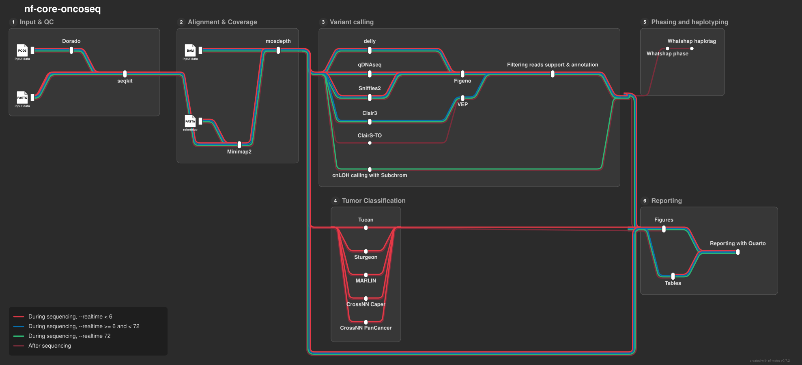

<h1>
  <picture>
    <source media="(prefers-color-scheme: dark)" srcset="docs/images/nf-core-oncoseq_logo_dark.png">
    
  </picture>
</h1>


[](https://www.nf-test.com)
[](https://www.nextflow.io/)
[](https://www.docker.com/)
[](https://sylabs.io/docs/)

## Introduction

**nf-core/oncoseq** is a pre-release pipeline for oncology research using Oxford Nanopore long-read sequencing. It processes POD5, basecalled reads or aligned BAM input for variant calling, copy number analysis, methylation-based classification and reporting.

The pipeline supports human reference assemblies hg38 (GRCh38), hg19 (GRCh37) and hs1 (CHM13 or t2t). Analysis availability depends on the reference and run mode. Results are intended for research, not clinical decision-making.



## Requirements

- [Nextflow](https://www.nextflow.io/) 26.04.0 or later, with a compatible Java installation. See the [Nextflow installation guide](https://www.nextflow.io/docs/latest/install.html).
- A supported container engine: Docker, Singularity or Apptainer. Select the corresponding Nextflow profile.
- Access to container images and the required reference files and models. Basecalling also requires a suitable Dorado execution environment.

## Quick start

Create a CSV samplesheet, for example `samplesheet.csv`, and replace the input path with your own POD5 data:

```csv
sample,input,tumor_type
sample1,/path/to/pod5,blood
```

Run from a checkout of this repository:

```bash
nextflow run . \
    -profile docker \
    --input samplesheet.csv \
    --outdir results \
    --basecall_model sup \
    --m_bases 5mCG_5hmCG
```

Replace `docker` with `singularity` or `apptainer` if appropriate. Pin a pipeline revision for reproducible analyses. Add `--ref_cache /path/to/reference/cache` to use local references and models. When a reference or VEP cache is unavailable locally, the pipeline may download it. The Nextflow launch host must have internet access for VEP cache downloads.

For existing basecalled FASTQ input, provide its path in the samplesheet and add `--skip_basecalling`. For coordinate-sorted, genome-aligned BAM input, add `--skip_mapping`. Supply `--basecall_model` for both starting points: the workflow uses it to select a Clair3 model. The pipeline can inspect existing reads for methylation tags when basecalling is skipped.

Pipeline parameters can be passed on the command line or in a Nextflow `-params-file`. Use `-c` for execution configuration rather than pipeline parameters. See the [nf-core configuration guide](https://nf-co.re/docs/running/configuration/configuration-options).

## Samplesheet

The samplesheet is a CSV file with one row per sample. `sample` and `input` are required. Sample identifiers cannot contain spaces. Paths must exist and be accessible to Nextflow.

| Column         | Description                                                                                           |
| -------------- | ----------------------------------------------------------------------------------------------------- |
| `sample`       | Unique sample identifier.                                                                             |
| `input`        | Path to the POD5, FASTQ or BAM input. Aligned BAM input must be coordinate sorted.                    |
| `tumor_type`   | `blood`, `brain`, `solid` or `other`. Selects classifier results for the report. Defaults to `other`. |
| `project`      | Project identifier for multiplexed samples.                                                           |
| `kit`          | Nanopore barcoding kit. Use with `project` and `barcode` for demultiplexing.                          |
| `barcode`      | Barcode identifier. Use with `project` and `kit` for demultiplexing.                                  |
| `ubam`         | Path to an incomplete uBAM for resuming basecalling.                                                  |
| `bed`          | Sample-specific BED file for adaptive sampling regions.                                               |
| `padding`      | Sample-specific padding around BED regions, in bases.                                                 |
| `low_fidelity` | Sample-specific file listing low-fidelity genes. Overrides `--low_fidelity` for that sample.          |
| `purity`       | Tumour purity estimate as a fraction from 0 to 1. Required in cfDNA mode.                             |
| `filter`       | `yes` or `no`, selecting cfDNA read-length filtering. Defaults to `yes` in cfDNA mode.                |

Enable demultiplexing with `--demux`. Supply `project`, `kit` and `barcode` for each multiplexed sample. The schema and input handling are defined in [`assets/schema_input.json`](assets/schema_input.json) and the pipeline initialisation workflow. Genome and reference selection use the global `--genome` and `--ref_cache` parameters.

## Analysis modes

- The default workflow runs the full analysis and performs variant phasing.
- `--realtime HOURS` selects real-time analysis for the given integer number of sequencing hours when cfDNA mode is not enabled. SNP calling starts at six hours. This mode does not perform the full workflow's phasing step.
- `--cfdna` selects cell-free DNA analysis. Each sample requires `purity`. SNP calling runs for samples with at least 10x coverage. This mode does not perform the full workflow's phasing step.
- In cfDNA mode, the samplesheet `filter` column selects whether to remove reads longer than `--max_length`, which defaults to 700 bases. FASTQ reads are filtered with Chopper before mapping; aligned BAM input is filtered with samtools.
- `--time_series` enables retrospective time-point analysis when the workflow is not in its real-time analysis branch. Set `--time_points` to a comma-separated list of hours. The default is `1,3,6,12,18,24,48,60,72`. `--include_full` also requests full-depth data; downstream outputs depend on the analysis mode.

`--cfdna` and `--realtime HOURS` can be used together. The workflow applies the cfDNA coverage threshold for SNP calling. The real-time option also enables sequencing-time reporting and changes caller selection: ClairS-TO is skipped when `--realtime` is set. The workflow can still enable `--time_series` for this combination. These descriptions reflect the current implementation; output availability depends on the input and run conditions.

## Pipeline overview

Depending on input and mode, the pipeline performs basecalling and demultiplexing with Dorado, read QC, alignment with minimap2, coverage analysis, small-variant and structural-variant calling, copy number analysis, annotation, phasing and report generation. Tools include Clair3, ClairS-TO, Sniffles2, Severus, Stellerator, QDNAseq, Delly, IchorCNA, NASVAR, VEP, PharmCAT and WhatsHap.

Methylation classification uses Classy when modified-base calls or input methylation tags are available. Classification is not run for hs1. The `tumor_type` column selects the results presented in the report. In the default full workflow, samples with sufficient adaptive coverage are downsampled to the first hour for classification; lower-coverage samples use the available reads. QDNAseq is skipped for hs1. IchorCNA runs in cfDNA mode, PharmCAT runs for hg38, and NASVAR is skipped for hg19. The availability of individual outputs depends on input, mode, coverage and reference.

## Key parameters

### Input and starting point

| Parameter            | Default  | Description                                                                                                                  |
| -------------------- | -------- | ---------------------------------------------------------------------------------------------------------------------------- |
| `--input`            | Required | Samplesheet CSV.                                                                                                             |
| `--outdir`           | Required | Output directory.                                                                                                            |
| `--basecall_model`   | Required | Basecalling model, for example `sup`, `hac` or `fast`. Also used for Clair3 model selection when starting with FASTQ or BAM. |
| `--m_bases`          | None     | Dorado modified-base model, for example `5mCG_5hmCG`, for methylation classification when basecalling.                       |
| `--skip_basecalling` | `false`  | Start with basecalled FASTQ reads.                                                                                           |
| `--skip_mapping`     | `false`  | Start with coordinate-sorted, genome-aligned BAM input.                                                                      |
| `--demux`            | `false`  | Enable demultiplexing using the samplesheet `project`, `kit` and `barcode` fields.                                           |

### Reference and targets

| Parameter        | Default       | Description                                                                                  |
| ---------------- | ------------- | -------------------------------------------------------------------------------------------- |
| `--genome`       | `hg38`        | Human reference assembly identifier.                                                         |
| `--ref_cache`    | None          | Reference FASTA or reference cache directory.                                                |
| `--vep_cache`    | None          | VEP cache location. If absent, a matching cache is located or downloaded.                    |
| `--bed`          | Bundled panel | BED file for adaptive sampling regions. A samplesheet `bed` can be supplied per sample.      |
| `--padding`      | `20000`       | Padding around target regions, in bases. A samplesheet `padding` can be supplied per sample. |
| `--low_fidelity` | Bundled list  | File listing low-fidelity genes for coverage analysis.                                       |

### Analysis options

| Parameter        | Default                   | Description                                                                                  |
| ---------------- | ------------------------- | -------------------------------------------------------------------------------------------- |
| `--cfdna`        | `false`                   | Enable cfDNA analysis. Each sample requires a `purity` value.                                |
| `--realtime`     | None                      | Provide the sequencing duration in integer hours for real-time processing and reporting.     |
| `--time_series`  | `false`                   | Enable retrospective time-point analysis when the real-time analysis branch is not selected. |
| `--time_points`  | `1,3,6,12,18,24,48,60,72` | Comma-separated time points in hours.                                                        |
| `--include_full` | `true`                    | Include full-depth data in time-series analysis. Downstream outputs depend on mode.          |
| `--max_length`   | `700`                     | Maximum read length in bases when cfDNA filtering is enabled.                                |

### Resources

| Parameter      | Default  | Description                                                                                                 |
| -------------- | -------- | ----------------------------------------------------------------------------------------------------------- |
| `--max_memory` | `400.GB` | Maximum memory for a process.                                                                               |
| `--max_cpus`   | `100`    | Maximum CPUs for a process.                                                                                 |
| `--max_time`   | `24.h`   | Maximum time for a process.                                                                                 |
| `--huge`       | `false`  | Scale resource requests for large datasets, subject to the configured limits.                               |
| `--wgs`        | `false`  | Declared for whole-genome basecalling resource allocation. The current workflow does not apply this option. |

Profiles can override these defaults. See [`nextflow_schema.json`](nextflow_schema.json), [`main.nf`](main.nf) and [`conf/params.config`](conf/params.config) for parameter definitions. Some schema defaults and types differ from the workflow declarations.

## Output

Results are written to `--outdir`. Published outputs include variant calls and copy number results under `variants/`, QC and classifier results under `reports/`, and execution metadata under `pipeline_info/`. Other process outputs are published under `program_outputs/`. Not every directory or result is produced in every mode.

The supplementary [usage guide](docs/usage.md) and [output guide](docs/output.md) contain further detail but may not reflect the current pre-release implementation. Check the configuration and workflow when relying on a specific option or output path.

## Development and testing

The repository includes nf-test suites and Nextflow test profiles. Run the affected tests when changing a workflow or module:

```bash
nf-test test --profile debug,test,apptainer --verbose
```

The `test` profile refers to data under `test_data/`; ensure the required fixtures are present before running it. The profile also enables Apptainer, which conflicts with a Docker profile in the current configuration. See the [contributing guidelines](.github/CONTRIBUTING.md) for development practices.

## Credits and support

nf-core/oncoseq was originally written by CHUSJ-MPGI. For help, contact the [nf-core Slack `#oncoseq` channel](https://nfcore.slack.com/channels/oncoseq); see the [Slack invitation](https://nf-co.re/join/slack).

## Citations

References for pipeline tools are listed in [`CITATIONS.md`](CITATIONS.md). Cite the nf-core framework publication:

> Ewels PA, et al. The nf-core framework for community-curated bioinformatics pipelines. _Nature Biotechnology_. 2020. doi: [10.1038/s41587-020-0439-x](https://doi.org/10.1038/s41587-020-0439-x).
